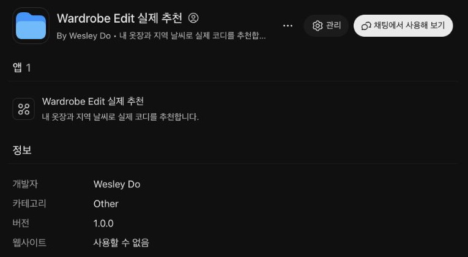
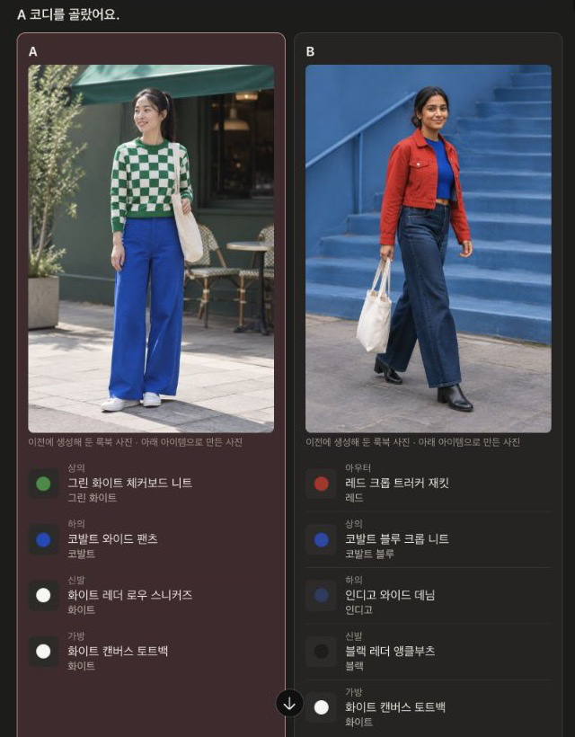
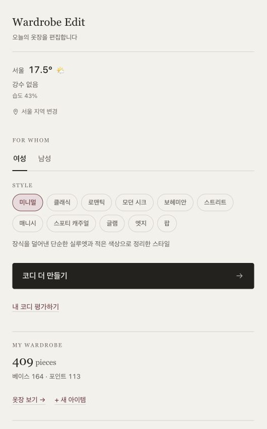
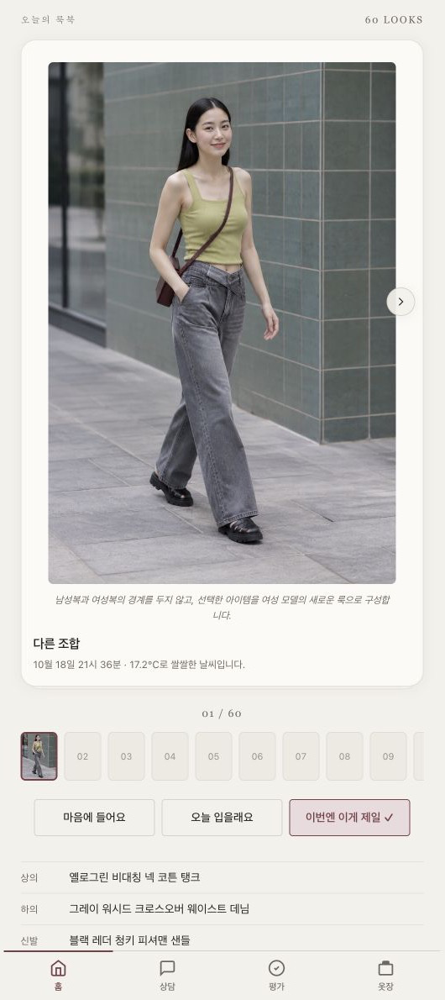
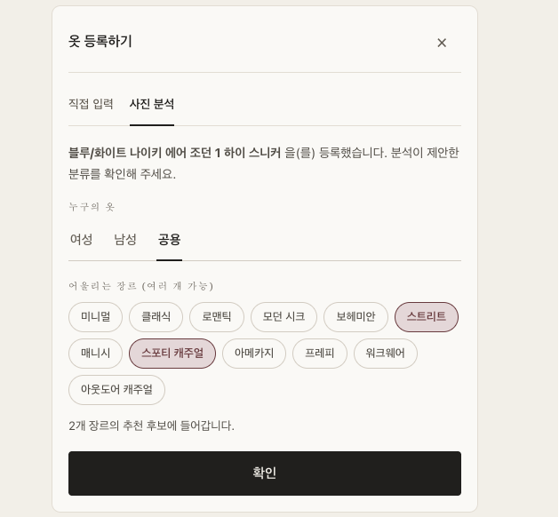
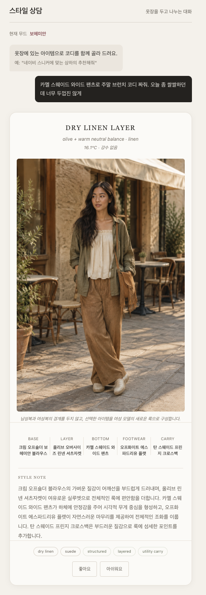

# Wardrobe Edit

내 옷장을 바탕으로, 오늘 입을 옷을 함께 고르는 AI 스타일링 서비스.

[](https://github.com/dasvador/style-engine/actions/workflows/ci.yml)

매번 대화창에 가진 옷과 날씨를 다시 설명하던 불편함에서 시작했습니다. 옷장과 추천 이력은 서비스에 남겨 두고, 웹이나 ChatGPT에서 원하는 상황과 스타일을 말하면 코디를 제안합니다.

사진으로 옷을 등록하고, 날씨와 취향에 맞는 조합을 찾고, 룩북으로 확인합니다. 추천 엔진 **Style Engine**은 LLM이 만든 후보를 보유 아이템·날씨·스타일 규칙으로 검증하고 최근 추천 이력을 반영합니다.

[ChatGPT 연결](#chatgpt에서-내-옷장-사용하기) · [웹 화면](#웹에서-사용하기) · [기술 요약](#기술-요약) · [로컬 실행](#로컬-실행)

## ChatGPT에서 내 옷장 사용하기

> “내 옷장에서 여성 미니멀 무드로 오늘 출근 코디 추천해줘.”

**계정을 연결하면 ChatGPT 대화에서 실제 옷장을 조회하고, 웹과 같은 엔진으로 코디를 추천받습니다.** 옷 목록을 매번 붙여 넣을 필요가 없습니다. 저장된 지역의 현재 날씨와 최근 추천 이력도 함께 사용합니다.

- **내 옷장 조회**: 연결된 계정의 아이템을 카테고리별로 확인합니다.
- **실제 코디 추천**: 상황·성별·무드를 받아 보유 아이템으로 조합하고, 구성 아이템과 선정 이유를 돌려줍니다.
- **계정별 데이터 분리**: OAuth로 연결한 사용자의 옷장만 조회하고, 추천 결과의 아이템 소유권도 확인합니다.
- **추천 이력 유지**: 결과를 서비스 DB에 기록해 다음 추천에서 반복을 줄이는 데 활용합니다. 실제로 입었다는 기록과는 구분합니다.

<p align="center">
  <br>
  <sub>ChatGPT에 연결된 실제 추천 앱. 옷장 조회와 코디 추천을 서비스 계정 기준으로 처리합니다.</sub>
</p>

```text
ChatGPT에서 요청
    → OAuth로 연결된 계정 확인
    → 내 옷장 + 저장된 지역의 날씨
    → Rust 추천 엔진: 후보 생성 · 검증 · 평가 · 이력 반영
    → 구성 아이템과 추천 이유를 대화로 전달
```

현재는 운영자가 발급한 일회용 코드로 계정을 연결하는 **시험 운영 단계**입니다. 실제 추천은 아이템과 설명을 반환하며, ChatGPT에서의 옷 사진 등록과 새 룩북 이미지 생성은 아직 지원하지 않습니다. [연결 방법과 구현 상세 →](mcp/README.md#계정-연결live-모드)

### 대화 안에서 코디 비교하기

MCP Apps로 코디 두 개를 나란히 보고 **A / B / 둘 다 아쉬움**을 선택해 이유를 저장하거나 수정할 수 있습니다.

<p align="center">
  <br>
  <sub>실제 ChatGPT에서 동작하는 비교 화면. 이 비교는 미리 준비한 룩북 사진을 사용하는 데모입니다.</sub>
</p>

**위 사진 비교는 샘플 데모이며, 앞의 실제 옷장 추천과 별도입니다.** 기존에 생성한 룩북 사진을 재사용하며 새 이미지를 생성하지 않습니다. 실제 추천 결과를 이 비교 화면에 바로 연결하는 기능은 아직 없습니다.

## 웹에서 사용하기

### 날씨·무드 선택과 룩북

미니멀부터 글램·엣지·팝까지 원하는 무드를 고르고, 추천 착장을 이미지와 아이템 구성으로 확인합니다. 만든 룩은 저장해 다시 보고 마음에 드는 조합을 표시할 수 있습니다.

<table>
  <tr>
    <td align="center" valign="top" width="50%">
      <br>
      <sub>날씨와 무드 선택 · 현재 웹 화면</sub>
    </td>
    <td align="center" valign="top" width="50%">
      <br>
      <sub>저장된 룩북과 코디 피드백 · 현재 웹 화면</sub>
    </td>
  </tr>
</table>

웹 화면은 2026-10-30 로컬 개발 환경에서 캡처했습니다. 룩북은 이전에 생성·저장한 결과이며, 화면의 옷장에는 사진 등록 아이템과 개발용 시드 아이템이 함께 들어 있습니다.

### 옷 등록과 스타일 상담

사진을 올리면 색감·소재·실루엣 등의 스타일 정보를 분석합니다. 저장 전 내용을 확인하고 수정할 수 있으며, 상담에서는 옷장 속 아이템을 중심으로 코디를 구성합니다.

<table>
  <tr>
    <td align="center" valign="top" width="50%">
      <br>
      <sub>사진 분석 결과 확인</sub>
    </td>
    <td align="center" valign="top" width="50%">
      <br>
      <sub>스타일 상담 예시 · 2026-10-15 캡처</sub>
    </td>
  </tr>
</table>

웹에서는 실제 추천 후보 두 개를 비교하고 선택 이유를 남기는 기능도 제공합니다. 수집한 선택은 추천 평가 데이터를 쌓는 데 사용합니다.

## 기술 요약

옷장 데이터와 추천 이력은 서비스가 관리하고, LLM은 후보 구성과 설명을 맡습니다. 웹과 ChatGPT가 같은 추천 엔진을 사용합니다.

### 모델 오케스트레이션

용도마다 요구가 다릅니다. 이미지 분석은 정확도가, 채팅은 응답 속도가, 룩북 이미지는 생성 품질이 중요합니다. 하나의 모델로 전부 처리하면 어딘가는 과하고 어딘가는 모자랍니다.

- **provider 2종**(OpenAI · Anthropic)을 공통 인터페이스 뒤에 두고, 요청 형식 차이는 각 구현체가 흡수합니다
- **태스크 12종**이 각각 모델과 파라미터를 따로 가집니다 — 코디 후보 생성, Vision 2단계, 코디 해설, 채팅 에이전트, 성별 검증, 이미지 생성, 이미지 편집, 임베딩 등
- 모델을 바꿀 때 코드가 아니라 설정만 고치면 됩니다

### 평가 파이프라인

추천 품질은 "좋아진 것 같다"로는 관리되지 않습니다. 규칙을 하나 고쳤을 때 다른 조건이 망가졌는지 알 방법이 필요합니다.

- 사람이 확인한 **고정 케이스 123건**으로 하드 필터와 적합도 판정을 측정합니다 (27건은 한 건씩 판단, 96건은 작성된 라벨을 검수 페이지에서 승인)
- 결과를 스코어카드로 남기고 **baseline과 비교해 회귀하면 테스트가 실패**합니다 — 정확도 하락뿐 아니라 새로운 false positive 발생도 잡습니다
- 현재 하드 필터 정확도 95.9%, false positive 3건이 기준선입니다
- 이미지 분석의 **레퍼런스 검색**도 별도 케이스 77건으로 같은 방식의 회귀 검사를 합니다 — 맞는 레퍼런스가 2차 분석에 전달되는 비율 100%, 1순위로 찾는 비율 93.5%

### 이미지 생성과 비용

이미지는 이 제품에서 비용이 나가는 거의 유일한 지점입니다(실측 장당 $0.0123, 채팅은 턴당 $0.0023).

- 착장 구성과 프롬프트의 해시로 **캐시**를 걸어 같은 요청의 이미지를 재사용합니다. 프롬프트가 바뀌면 새로 생성하되, 룩북에 저장한 사진은 유지합니다
- 생성 후 **검증 단계**를 두고, 통과하지 못한 사실도 캐시에 남겨 같은 착장이 매번 재생성되지 않게 합니다
- 생성당 비용과 하루·한 달 누적 지출을 기록합니다. 예산 상한 검사 로직은 현재 비활성화돼 있습니다
- 상담에서 "신발만 바꿔줘"처럼 1~2개만 바뀌면 **앞 사진 편집을 우선 시도**합니다. 모델·표정·포즈·배경을 유지하도록 요청하며, 편집에 실패하면 새로 생성합니다
- 착용 사진이 안전 검사에 차단되면 **인물 없는 의류 배치 이미지**를 시도하고 화면에 구분해 표시합니다. 대체 이미지도 제공할 수 없으면 추천 내용과 안내를 보여줍니다

### 그 밖의 구조

- **2-Pass RAG**: 1단계에서 옷의 외형을 서술하고, 임베딩 검색으로 찾은 레퍼런스를 참조해 2단계에서 정밀 분석합니다. 레퍼런스 52개는 사람이 검수한 것만 검색에 쓰고, 같은 의류 카테고리끼리만 비교합니다
- **타입으로 고정한 어휘**: 역할·톤·스타일·장르를 문자열이 아닌 enum으로 두어, 표준 밖의 값은 컴파일이나 행 디코딩에서 걸립니다 — 같은 버그를 두 번 낸 뒤 도입했습니다

## 추천 방식

Wardrobe Edit은 LLM의 응답을 그대로 추천 결과로 사용하지 않습니다. 후보 생성과 평가, 최종 노출 순위를 서로 다른 단계로 나눴습니다.

```text
사용자 옷장
+ 날씨와 상황
+ 스타일 선호
+ 최근 추천 이력
        ↓
후보 아이템 선별
        ↓
LLM 코디 후보 생성
        ↓
규칙 기반 적합성 검사와 점수 계산
        ↓
최근 노출·다양성·당일 적합도 반영
        ↓
추천 결과와 선택 이유 제공
```

### 1. 후보 아이템 선별

옷장 전체를 모델에 전달하지 않고 상황, 기온, 아이템 역할, 최근 사용 여부를 기준으로 후보를 줄입니다. 입력 크기를 제한하면서도 필요한 카테고리가 고르게 포함되도록 구성했습니다.

- 상황에 맞지 않는 옷은 미리 뺍니다(출근에 운동화 등). 빼고 나서 2개 미만이 남는 칸은 빼지 않습니다
- 고른 무드 안에 출근·데이트에 맞는 옷이 모자라면, 가까운 무드의 옷을 빌려와 채웁니다
- 글램은 후보 생성부터 무드를 전달합니다. 옷(상의·하의·아우터) 한 곳에 시선이 모이는 중심을 두도록 지시하고, 옷에 글램 요소(새틴·벨벳·메탈릭 소재나 원숄더·드레이프 실루엣)가 없는 후보는 추천 자리에서 뺍니다 — 가방·신발만으로는 글램이 되지 않습니다. 그런 후보가 하나도 없으면 옷장 안에서 한 슬롯만 바꿔 최대 2개를 보완합니다(`services::mood_rules`, `mood_gate`)
- 엣지도 같은 경로를 씁니다. 옷(상의·하의·아우터)에 형태(비대칭·각진 어깨·배럴 레그·박시 크롭)나 가죽이 있어야 엣지로 보고, 기본 티·데님에 가죽 부츠·가방만 더한 조합은 뺍니다. 엣지 채점은 조용한 아우터 안의 형태 있는 상의, 형태가 중심인 하의, 소재·형태 대비가 있는 어두운 코디의 감점만 되돌리고 격식 상한은 그대로 둡니다
- 날씨에 맞는 후보가 하나도 없으면 실패한 후보를 되돌려 넣지 않고, 아우터를 바꾸는 보완 뒤에도 없으면 후보 부족을 알립니다

### 2. 코디 후보 생성

LLM은 선별된 아이템 안에서 복수의 코디 후보를 구성합니다. 호출부는 특정 모델명이 아니라 `VisionPass1`, `Recommendation`, `StyleNote`와 같은 작업을 지정합니다. 실제 provider와 모델은 설정에서 교체할 수 있습니다.

### 3. 규칙 기반 평가

각 후보는 다음 네 가지 축으로 평가합니다.

| 평가 축 | 확인하는 내용 |
| --- | --- |
| Balance | 아이템의 역할과 시각적 무게가 균형을 이루는지 |
| Coherence | 색온도, 스타일, 소재가 자연스럽게 연결되는지 |
| Utility | 계절, 기온, 상황과 격식에 적합한지 |
| Accessory | 신발과 가방이 전체 조합을 보완하는지 |

명확한 충돌은 hard filter에서 제외하고, 통과한 후보에는 0~100 범위의 스타일 점수를 계산합니다.

### 4. 최종 순위 조정

기본 점수에 최근 추천 페널티와 다양성 보너스, 당일 날씨 적합도를 반영합니다. 같은 아이템과 비슷한 조합이 반복되는 현상을 줄이기 위한 단계입니다.

점수가 높아도 오늘 입기에 "실패"로 판정된 코디(출근에 후드티 + 스웻팬츠 등)는 추천 자리에서 뺍니다. 후보가 전부 실패면 빈 추천 대신 원래 후보를 그대로 씁니다.

## 코디 평가 예시

```json
{
  "score": 74,
  "verdict": "Good",
  "summary": "전체적인 색감은 안정적이지만 출근 상황에 비해 신발이 다소 캐주얼합니다.",
  "strengths": [
    "상의와 하의의 색온도가 자연스럽게 연결됩니다."
  ],
  "problems": [
    {
      "code": "FormalitySituationMismatch",
      "deduction": 12,
      "detail": "현재 신발은 나머지 아이템보다 격식 수준이 낮습니다."
    }
  ],
  "suggestions": [
    {
      "type": "upgrade_formality",
      "recommended_colors": ["네이비", "차콜"],
      "recommended_examples": ["로퍼", "미니멀한 가죽 스니커즈"]
    }
  ]
}
```

점수, 판정, 문제와 제안은 규칙 엔진이 생성합니다. LLM은 이 구조화된 결과를 읽기 쉬운 설명으로 정리합니다. 설명 생성에 실패하더라도 평가 결과는 그대로 사용할 수 있습니다.

## 이미지 분석

등록한 옷은 두 단계로 분석합니다.

```text
이미지 업로드
    ↓
Vision 1차 분석: 눈에 보이는 특징 정리
    ↓
Embedding 검색: 유사한 의류 레퍼런스 탐색
    ↓
Vision 2차 분석: 레퍼런스와 함께 세부 속성 확인
    ↓
사용자 옷장에 저장
```

첫 분석에서는 확인되지 않은 브랜드나 모델명을 추측하지 않습니다. 레퍼런스는 첫 분석이 판단한 의류 카테고리 안에서만 찾고, 그 카테고리에 레퍼런스가 없거나 유사도가 충분하지 않으면 레퍼런스 없이 일반 분석 결과를 저장합니다. 자동으로 생성된 속성은 사용자가 직접 수정할 수 있습니다.

레퍼런스는 `data/clothing_references.toml` 에서 관리합니다. 각 항목은 형태·소재·식별 디테일과 함께 **혼동하기 쉬운 옷**과 **사진만으로 확정할 수 없는 것**을 적어 두어, 레퍼런스가 정답처럼 쓰이지 않게 합니다. 새로 쓴 레퍼런스는 사람이 검수해 승인하기 전까지 검색에 쓰이지 않습니다.

## 품질 검증

스타일 판단은 주관적일 수 있지만, 엔진 변경이 기존 결과를 예상치 못하게 훼손하는지는 반복해서 확인할 수 있어야 합니다.

- 123개의 라벨링된 평가 케이스 운영
- hard filter, 당일 적합도, 선호 조합 순위 지표 측정
- 기준선보다 결과가 나빠지면 CI 실패
- 규칙별 단위 테스트와 평가 스코어카드를 분리
- 새로운 랭킹 로직은 기존 결과와 함께 실행하는 shadow mode로 비교

현재 저장된 스코어카드:

| 지표 | 결과 |
| --- | ---: |
| Hard filter 정확도 | 95.9% |
| Today-fit 정확도 | 79.7% |
| 선호 조합 순위 정확도 (기온 케이스 제외) | 74.7% |
| Hard filter와 Today-fit 동시 일치 | 77.2% |
| 사람이 고른 쌍과 일치 (운영 / shadow 엔진, 16쌍) | 68.8% / 50.0% |
| 홈 추천 반응으로 정해진 쌍과 일치 (운영 / shadow / 화면 순서, 30쌍) | 48.3% / 50.0% / 60.0% |

레퍼런스 검색 스코어카드 (케이스 77건: 정답 있음 62, 정답 없음 15):

| 지표 | 결과 |
| --- | ---: |
| 정답이 1순위 (Recall@1) | 93.5% |
| 정답이 2차 분석에 전달되는 상위 5개 안 (Recall@5) | 100% |
| MRR | 0.965 |

이 수치는 실제 사용자 만족도가 아니라 저장된 평가 케이스에 대한 결과입니다. 평가 데이터의 범위와 라벨 품질에 따라 달라질 수 있습니다.

## LLM 연동

모든 모델 호출은 공통 client를 거칩니다.

```text
호출부: 작업 종류만 지정
        ↓
LlmClient
- 작업별 provider/model 선택
- timeout과 지수 백오프 재시도
- 응답 스키마 검증
- 토큰·지연시간·추정 비용 기록
        ↓
OpenAI / Anthropic provider
```

Chat, Embedding, Image 기능을 별도 interface로 구분했습니다. provider가 지원하지 않는 기능을 컴파일 시점과 설정 단계에서 명확히 구분하기 위한 구조입니다.

## 기술 구성

| 영역 | 기술 |
| --- | --- |
| Backend | Rust, Axum, Tokio |
| Frontend | React 18, TypeScript, Vite |
| ChatGPT 연동 | Node.js, MCP SDK, MCP Apps, OAuth 2.1 / PKCE |
| Database | MySQL, sqlx |
| AI | OpenAI API, Anthropic API, Vision, Embedding, Image Generation |
| External data | 기상청 초단기실황 API, Open-Meteo fallback |
| Delivery | Docker, GitHub Actions |

운영 환경에서는 Axum이 API와 React SPA를 같은 origin에서 제공합니다. 프런트엔드와 백엔드는 코드로 분리하되 하나의 컨테이너로 배포할 수 있습니다.

```text
Browser
  ├─ /api/*      → Axum handlers → MySQL / external APIs
  ├─ /static/*   → uploaded and generated images
  └─ other paths → React SPA
```

## 주요 API

| Method | Path | Description |
| --- | --- | --- |
| POST | `/api/clothes/upload` | 이미지 분석 후 옷장에 등록 |
| GET | `/api/clothes` | 옷장 목록 조회 |
| POST | `/api/outfit/evaluate` | 선택한 코디 평가 |
| POST | `/api/recommendation/multi` | 복수 후보 생성·평가 후 추천 |
| POST | `/api/chat` | 도구 호출 기반 스타일링 대화 |
| POST | `/api/chat/image` | 착장 룩북 이미지 생성 |
| POST | `/api/feedback` | 선호·비선호 피드백 저장 |
| GET | `/api/style-moods` | 성별별 스타일 장르 목록 조회 |
| GET | `/api/weather` | 현재 날씨 조회 |
| GET | `/api/user/me` | 토큰 주인(사용자 id·이름) |
| GET | `/api/images/{file}` | 본인 생성 코디 사진 |
| GET | `/api/health` | 서비스 상태 확인 |

## 로컬 실행

### 요구사항

- Rust (`rust-toolchain.toml`에 버전 고정)
- Node.js 20 이상
- MySQL 8.0 이상
- OpenAI API key

### Backend

```bash
cp .env.example .env
mysql -u root -e "CREATE DATABASE rust_web_app"
cargo run
```

Backend는 기본적으로 `http://localhost:3003`에서 실행됩니다.

#### 인증

개인 API(옷장·추천·상담·룩북·비교·피드백·사진·지역/날씨)는 기본적으로 `Authorization: Bearer <api_token>`이 필요합니다. MCP 실제 추천은 아래의 서명된 위임 경로를 사용합니다.
토큰이 없거나 틀리면 401입니다(`default` 사용자로 바꾸지 않습니다). 옷장은 계정별로 나뉩니다(`clothing.user_id`).
기존 옷은 모두 `default` 소유로 남습니다.

웹은 브라우저에 저장한 API 토큰을 전송하지만 로그인 화면은 아직 없습니다. 토큰 없이 로컬에서 확인하려면 다음을 켭니다. 그러면 **이 컴퓨터에서 직접 온** 토큰 없는 요청을 `default`로 봅니다.
루프백 연결·localhost Host·전달 헤더 없음·로컬 Origin을 모두 만족해야 합니다. 터널·프록시를 거친 요청은 해당하지 않습니다.

```bash
WARDROBE_AUTH_MODE=dev-default-loopback cargo run
```

계정별로 나뉘는 것과 공용인 것:

- **계정별**: 옷장, 지역(날씨 기준 위치), 생성 코디 사진 캐시, 룩북, 비교·선택, 피드백, 상담 기록.
  - 사진 캐시 키에 소유자가 들어갑니다. 다른 계정이 같은 착장 문구를 보내도 그 계정의 사진을 받거나, 그 계정의 룩에 사진을 붙이지 않습니다.
  - 새 계정은 지역을 정하기 전까지 지역이 없습니다(다른 계정 위치를 대신 쓰지 않음).
- **공용**: 레퍼런스 카탈로그와 스타일 무드 목록. 읽기는 누구나, 카탈로그 수정은 관리자만 합니다.
  관리자는 `WARDROBE_ADMIN_USERS=<사용자 id,...>`이거나, 개발 모드의 로컬 요청(`default`)입니다. 새로 가입한 계정은 403입니다.

생성 코디 사진의 공개 경로(`/static`)는 개발 모드의 로컬 요청에만 열립니다. 토큰 사용자는 `GET /api/images/{file}`로 본인 사진만 받습니다.
응답은 `Cache-Control: private, no-store`, `Vary: Authorization`라 계정을 바꿔도 브라우저 캐시에 앞 계정 사진이 남지 않습니다.
이 포트(3003)를 터널로 공개하지 마세요. ChatGPT 연결은 `mcp/`의 live 모드(OAuth)로 합니다.

계정 분리 마이그레이션 세 개(`20261024000001_clothing_owner`·`20261024000002_outfit_image_owner_key`·`20261024000003_region_owner`)는
서버를 켤 때 자동 적용됩니다. 배포 DB에 먼저 적용해야 `mcp/` live 모드도 시작합니다.

ChatGPT 계정 연결은 **시험 운영** 단계입니다. 운영자가 발급한 일회용 코드로만 연결되고, live MCP 서버는 프로필·옷장을 3003 없이 DB에서 직접 읽습니다(읽기 전용).
실제 코디 추천(`recommend_my_outfit`)만 3003의 `/api/recommendation/multi`를 부릅니다. 이때 3003은 이 컴퓨터에서만 받게 띄우고, 두 서버에 같은 위임 키를 줍니다.
MCP는 OAuth로 확인한 계정을 이 키로 서명해 보내고, 3003은 로컬 직접 요청·추천 경로·서명이 모두 맞을 때만 받습니다.

```bash
WARDROBE_BIND_HOST=127.0.0.1 WARDROBE_DELEGATION_KEY=<32바이트 이상 hex> LLM_MAX_RETRIES=0 cargo run
```

`WARDROBE_BIND_HOST`가 없으면 예전처럼 모든 인터페이스에서 받습니다. `WARDROBE_DELEGATION_KEY`가 없으면 위임을 받지 않습니다.
일반 웹 로그인 화면과 사진 인증 화면은 아직 없습니다. 자세한 상태와 남은 일은 `mcp/README.md`의 "계정 연결(live 모드)"에 있습니다.

화면(프런트)의 현재 한계(로그인 화면은 다음 범위):

- 토큰 없이 쓰려면 위 개발 모드가 필요합니다. 개발 모드가 꺼져 있으면 화면에 "로그인이 필요해요 …" 안내가 나옵니다.
- 다른 계정으로 시험하려면 `POST /api/user/register`로 받은 토큰을 브라우저 저장소 `wardrobe.apiToken`에 넣습니다. API 요청에 실려 갑니다.
  다만 이 경우 사진(``)은 보이지 않습니다. 보호 경로는 헤더가 필요해 ``로 못 읽습니다.
- Vite 개발·프리뷰 서버는 `127.0.0.1`에만 열립니다. `--host`로 열어도 `/api`·`/static` 프록시는 이 컴퓨터에서 직접 연 브라우저의 요청만 넘깁니다(루프백 연결·로컬 Host·전달 헤더 없음, 나머지는 403). 프록시가 바깥 요청을 "로컬"로 바꿔 개발 모드를 통과시키지 않게 하려는 것입니다.

### Frontend

```bash
cd frontend
npm install
npm run dev
```

개발 서버는 `http://localhost:5173`에서 실행되며 `/api` 요청을 backend로 전달합니다.

### Production build

```bash
cd frontend && npm run build && cd ..
cargo build --release
./target/release/style-engine
```

### Docker

```bash
docker build -t style-engine .
docker run --rm -p 3003:3003 --env-file .env \
  -v "$PWD/static/images:/app/static/images" \
  style-engine
```

## 테스트

```bash
cargo fmt --check
cargo clippy --all-targets -- -D warnings
cargo test --all-targets
cargo test --test eval_scorecard -- --nocapture
cargo test --test retrieval_eval -- --nocapture

cd frontend
npm run build
npm run lint
```

GitHub Actions에서 format, lint, 전체 테스트와 두 스코어카드(추천 평가, 레퍼런스 검색)의 회귀 검사를 실행합니다. 레퍼런스 검색은 임베딩 API 를 부르지 않고 커밋된 벡터 스냅샷으로 재며, 레퍼런스 문장을 고치면 `python3 tools/retrieval-eval/embed.py` 로 스냅샷을 갱신해야 테스트가 통과합니다.

## License

[MIT](LICENSE)
